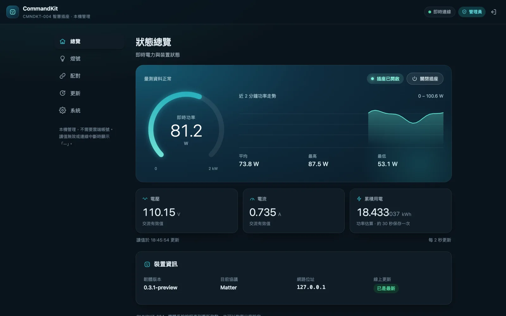
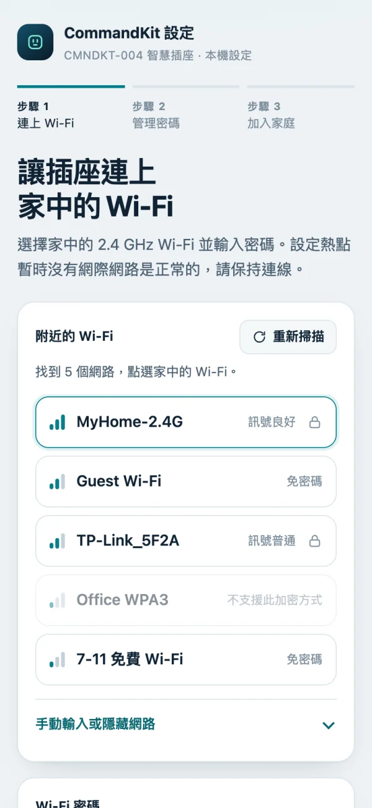
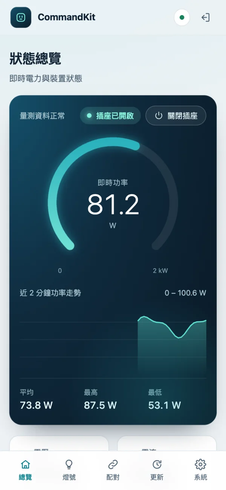

# Incipio CommandKit

Preview Matter/HomeKit firmware and interoperability research for an owned CMNDKT-004 / RTL8196E smart outlet.

繁體中文：[README.md](README.md)

**The 8 MiB BIN is an address-aligned partial image.** Only Bank 1 rootfs contains data; other regions are `0xFF`. Personalize it locally and write only the allowed region. Preserve each outlet's MAC, MIB, calibration, HomeKit/MFi data and Bank 2. It cannot initialize a blank chip or restore a whole device.

**Disconnect mains power before opening or flashing the outlet.** Confirm 3.3 V and remove other power sources. Disconnect the programmer and all wires, then close the enclosure before applying mains power.

 

Screens show synthetic data.

## Install

Start with the [installation website](https://lee98064.github.io/incipio-commandkit/). There are two ways to do the first install:

| Method | Works with | How |
|---|---|---|
| **Factory web upload (no opening)** | Factory `10219-1531`, Active Bank 2, Dual Firmware enabled | Upload the release's `commandkit-matter-v0.3.1-public-first-install.bin` on the factory `/upload.htm` page; tested on a real outlet. See the [factory web install guide](docs/install/factory-install.md) (Chinese). |
| **Flash programmer** | Any factory version | Back up with a CH341A, personalize, and write only the Bank 1 rootfs. See the [flashing guide](docs/install/flashing.md) (Chinese). |

For an existing custom installation, open `http://OUTLET_IP:18082/`, sign in and use the Updates tab, or upload `matter.ota`. Normal OTA preserves identity, Wi-Fi, password, pairings and kWh. Upgrading from firmware without an admin password requires Wi-Fi and password setup again.

## Features

- Switch between HomeKit and Matter while retaining saved pairings and settings.
- Three-step Wi-Fi, password and household setup wizard.
- Guest status view and password-protected management, mobile navigation and dark mode; admins can switch the outlet on or off from the web page (Matter mode).
- Matter and web voltage, current, power and estimated energy; custom live metering pauses in HomeKit mode.
- Six LED modes, outlet identification and night schedule.
- Automatic update checks, installation steps, Ed25519 verification and reset controls.

## Documentation and development

Most documentation is in Traditional Chinese.

| Topic | Link |
|---|---|
| All documentation | [Index](docs/README.md) |
| Operation and updates | [Usage](docs/guide/usage.md), [updates](docs/guide/updates.md) |
| Build and release | [Build](docs/development/build.md), [release](docs/development/releasing.md) |
| Contribute and report security issues | [Contributing](CONTRIBUTING.md), [security](SECURITY.md) |
| Research and validation | [Reverse index](reverse/README.md), [verification](verification/README.md) |
| Published changes | [Changelog](CHANGELOG.md) |

`firmware/` holds firmware, `tools/` host tools, `tests/` checks, `docs/` guides and reports, `reverse/` research, and `third_party/` dependency records. `firmware/exec-test` is a retired diagnostic variant. Vendor decompilation and symbols are archived separately and kept out of Git.

## License

[MIT](LICENSE) covers code and documentation written for this project. It excludes vendor firmware bytes and vendor-derived reverse-engineering material, `third_party/**`, `firmware/matter/src/vendor/**`, `firmware/matter/src/sdk-overrides/**`, `firmware/matter/src/matter-app-device/build_overrides/**`, and the executables in `firmware/exec-test/samples/*`.

Monocypher retains BSD-2-Clause/CC0, qrcodegen retains Nayuki's MIT, and the SDK and GN overrides retain their connectedhomeip Apache-2.0 provenance. See [third-party notices and exceptions](third_party/README.md).

## Disclaimer

This project is independent of Incipio and intended for research on owned devices. It is preview firmware using development attestation, with no claim of commercial certification. VM and fixture results do not establish hardware, RF, load, power-loss or long-term reliability.
