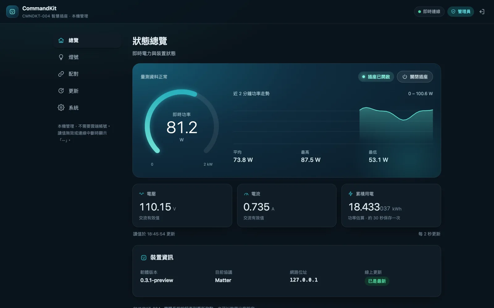
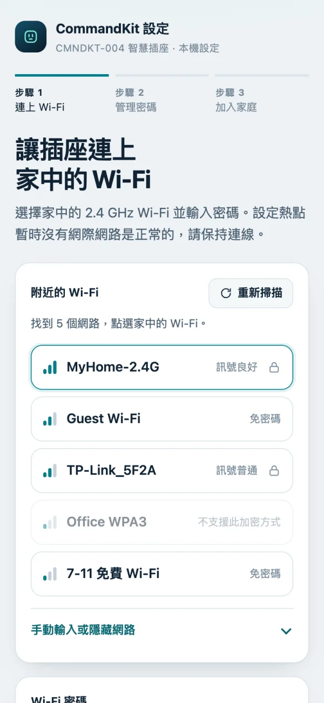
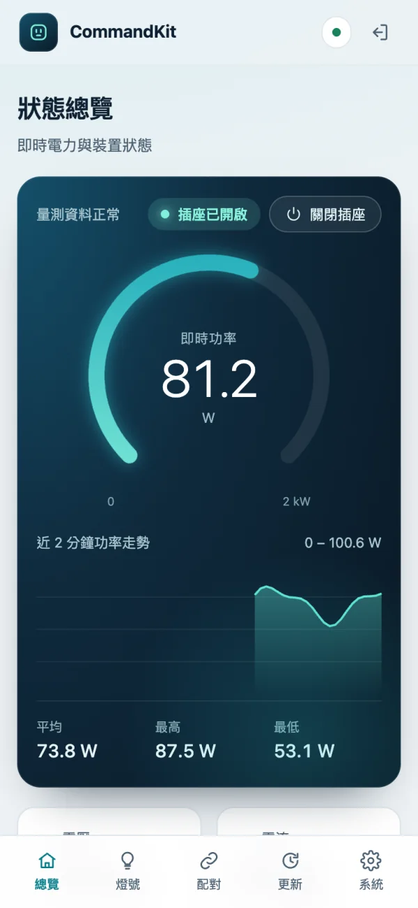

# Incipio CommandKit

自有 CMNDKT-004／RTL8196E 智慧插座的 Matter／HomeKit 預覽韌體與互通性研究。

[](https://github.com/lee98064/incipio-commandkit/releases)
[](LICENSE)
[](https://lee98064.github.io/incipio-commandkit/)

English: [README.en.md](README.en.md)

**Release 的 8 MiB BIN 是位址對齊的「部分燒錄映像」，不是整片還原映像。**只有 Bank 1 rootfs 有內容；其餘區域為 `0xFF`。請用本專案工具個別化後限定區域寫入，保留每台插座自己的 MAC、MIB、校正、HomeKit／MFi 與 Bank 2。對空白晶片直接刷入公開 BIN 無法建立完整可開機裝置。

市電插座拆機／燒錄時必須斷開市電，確認 3.3 V 並移除其他供電。完成後移除燒錄器及所有外接線，再裝回外殼上電。



<p> </p>

畫面為示意資料。

## 安裝說明

從[安裝網站](https://lee98064.github.io/incipio-commandkit/)開始；備份、個別化、限定區域寫入與復原見[燒錄說明](docs/install/flashing.md)。符合條件的原廠 10219／Bank 2 可使用[網頁首次安裝](docs/install/factory-install.md)。

已安裝自訂韌體：開啟 `http://插座IP:18082/`，登入後在「更新」分頁下載安裝，或手動上傳 Release 的 `matter.ota`。一般 OTA 保留身分、Wi-Fi、密碼、配對與累積 kWh；從無管理密碼的舊版首次升級須重新設定 Wi-Fi 及密碼。詳見[更新說明](docs/guide/updates.md)。

## 功能

- HomeKit／Matter 單選切換，保留既有配對與設定；同時只有一個 MCU 控制程序。
- 三步驟設定熱點：選擇 Wi-Fi、建立管理密碼、加入家庭。
- 訪客狀態頁與密碼管理後台，含分頁、手機介面、深色模式。
- Matter 與網頁 V／A／W／估算 kWh、即時功率走勢；HomeKit 模式暫停自訂即時量測及 kWh 累計。
- 六種 LED 模式、尋找插座、夜間熄燈及校時備援。
- 開頁自動檢查更新、分步安裝、Ed25519 簽章驗證、配對重設與完整出廠重置。

## 文件

| 內容 | 入口 |
|---|---|
| 全部文件 | [文件索引](docs/README.md) |
| 使用、配網與管理 | [使用說明](docs/guide/usage.md)、[管理後台](docs/guide/admin-backend.md) |
| 更新、指示燈與量測 | [更新](docs/guide/updates.md)、[LED](docs/guide/led-control.md)、[電力量測](docs/guide/measurements.md) |
| 協議與配對 | [協議切換](docs/guide/protocol-switching.md)、[Matter 重設](docs/guide/matter-reset.md) |
| 安裝與復原 | [燒錄](docs/install/flashing.md)、[原廠網頁安裝](docs/install/factory-install.md) |
| 建置與身分 | [建置](docs/development/build.md)、[自動身分](docs/development/automatic-identity.md) |
| 隱私與架構 | [去識別化](docs/development/privacy.md)、[技術報告](docs/development/technical-report.md) |
| 維護與發布 | [發布流程](docs/development/releasing.md)、[版本紀錄](CHANGELOG.md) |
| 研究與驗證 | [逆向索引](reverse/README.md)、[驗證索引](verification/README.md) |

## 目錄結構

```text
.github/       CI、發布、Pages 與協作範本
docs/          guide、install、development、reports 與畫面
firmware/      韌體來源與測試；firmware/exec-test 為已停止發行的舊診斷版
reverse/       研究文件、asm、人工語義模型與重現工具
site/          GitHub Pages 安裝網站（繁中／English）；部署時加入 updates/ 更新索引
tests/         主機、Linux、MIPS 與發布檢查
tools/         建置、安裝、更新與公開包稽核
third_party/   固定依賴、來源與既有授權
verification/  歷史驗證摘要與雜湊
```

原廠反編譯與符號已另存研究封存，未納入 Git；不是原廠原始碼，也不能直接編譯。取得方式見[逆向索引](reverse/README.md)。

## 開發

環境、測試、管理頁預覽與提交規則見 [CONTRIBUTING.md](CONTRIBUTING.md)。安全問題請依 [SECURITY.md](SECURITY.md) 私下回報。

## 授權

[MIT](LICENSE) 僅涵蓋本專案撰寫的程式與文件。原廠韌體 bytes、原廠衍生逆向資料、`third_party/**`、`firmware/matter/src/vendor/**`、`firmware/matter/src/sdk-overrides/**`、`firmware/matter/src/matter-app-device/build_overrides/**` 及 `firmware/exec-test/samples/*` 執行檔不在此授權範圍。

Monocypher 保留 BSD-2-Clause／CC0 雙授權，qrcodegen 保留 Nayuki MIT；SDK overrides 與 GN overrides 保留 connectedhomeip Apache-2.0 來源與標頭。其餘元件及個別例外見 [third_party/README.md](third_party/README.md)。

## 免責聲明

本專案與 Incipio 無隸屬或背書關係，僅供自有裝置研究。這是預覽韌體，使用開發測試 attestation，不宣稱商用認證；VM／fixture 測試不能代替原機、RF、負載、斷電及長期穩定性驗收。使用者須自行評估硬體、資料與供電風險。
