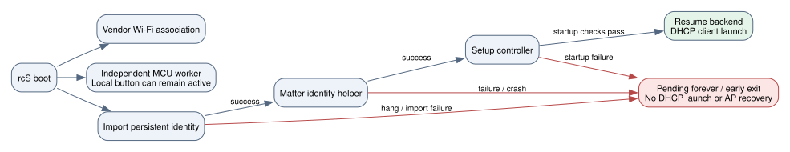

# CMNDKT-004 升級後 Wi-Fi 回連失敗分析

日期：2026-10-20，Asia/Taipei。報告 flavor：null。範圍見 [scope](wifi-startup-analysis/scope.md)，順序見 [timeline](wifi-startup-analysis/timeline.md)。

後續修復的完整開機測試已找到更早的確定失敗：原廠 BusyBox 沒有 `touch` applet，v0.2.6 rootfs 也沒有外部 `touch`；其 `ck-ota-start` 第 5 行會在匯入金鑰之前退出 127。本報告原先的故障注入雖使用原廠 ash，仍借用主機 PATH 工具，漏掉了這項差異。原有依賴與恢復缺口仍成立；補充證據、v0.2.7 修正及完整開機驗證以[修復報告](2026-10-20_firmware-wifi-recovery-report.md)為準。

## 結論

目前韌體確實有「身分初始化失敗會連帶阻止 DHCP 啟動」的缺口，已用實際送出 OTA 內的啟動腳本重現。它可以造成無線仍關聯、按鍵仍可切換，卻沒有可用 IPv4、管理網頁或設定熱點。這是已驗證的失敗路徑；**尚無更新後實體開機日誌，不能確定這顆插座此次是否走到該路徑，也不能宣告特定程序已崩潰。**

實體觀察較符合「Wi-Fi 關聯之後、DHCP 啟動或完成之前」出問題。UniFi 的 SSID／VLAN 對應一致；租約表未查到目標 MAC，因此介面顯示的舊 IP 並不足以證明更新後已取得新租約。這些是控制器觀察，沒有 DHCP 封包擷取，仍可能存在控制器資料延遲或其他網路問題。

## 實際映像比較

對照的是原廠網頁通道使用的 v0.2.4 私人首次安裝 BIN，以及之後提交的 v0.2.6 `matter.ota`，不是只比較 Git HEAD。兩份 rootfs 均通過格式／checksum 檢查。

| 項目 | v0.2.4 → v0.2.6 |
|---|---|
| rcS、inittab、vendor init／startup | 逐 byte 相同 |
| BusyBox、libapmib、ck-wificfg、ck-lease、DHCP callback | 逐 byte 相同 |
| 身分匯入／setup／diagnostic 啟動腳本 | 改為公開版自動身分匯入與 pending 等待 |
| rootfs 內 bootstrap device／diag key | v0.2.4 私人版具備；v0.2.6 公開版沒有，必須由 journal 匯入 |
| Matter、updater、setup 控制器 | 執行檔有變更 |

因此目前沒有證據顯示升級替換了 Wi-Fi 驅動或 WPA 設定程式。正常 OTA 的 rootfs 範圍是 `[0x130000,0x3C0000)`，Wi-Fi 設定保存在 vendor MIB，與 RAM 裡的 Matter 身分檔案不同。這不等於已在實體上排除 MIB 損壞、寫入故障或 RF 問題。

## 啟動依賴與已重現的情況



圖中的三條開機支線表示程序依賴，不表示 rcS 同時執行所有命令；可編輯來源見 [startup.dot](wifi-startup-analysis/startup.dot)。

`ck-setup-start` 先等 `ck-identity-pending` 消失，再執行 `matterd-test --init-identity wlan0`。只有成功後才啟動 `ck-setupd`。控制器又先檢查配對碼、管理金鑰、亂數和監聽 socket，通過後才呼叫 `ck-setup-backend resume` 啟動 `udhcpc`。Wi-Fi 關聯可由先前的 vendor 初始化完成，所以不能用「AP 看得到它」推論 DHCP／應用服務已起來。

| 情況 | 驗證結果 | 與本次症狀的關係 |
|---|---|---|
| 公開版匯入回傳失敗，或 importer 子程序崩潰 | rescue 會建立、pending 會清除，但沒有 bootstrap device key；身分 helper 失敗，setup 控制器與 DHCP 都未啟動 | 高度相符；實體是否有匯入錯誤仍待日誌 |
| importer 卡住，或其背景初始化 shell 被終止 | pending 留存；setup 與診斷腳本無期限等待 | 高度相符；實體是否發生卡住／OOM 未證實 |
| `--init-identity` 失敗或崩潰 | setup wrapper 直接退出，沒有重啟；DHCP 未啟動 | 可重現；缺 key、無有效 wlan0 MAC、寫 RAM 失敗等也會回傳失敗，未必是 crash |
| setup 控制器啟動檢查失敗或 MIB status 失敗 | 在啟動 resume 前退出；沒有外部 supervisor 重啟 | 可重現／來源碼確認；實體原因未定 |
| DHCP child 未啟動或取得租約失敗，但 setup 控制器仍存活 | 正常應在約 120 秒後嘗試 AP；child 的 stderr 目前被丟棄 | 單獨此情況通常還應看到 AP 嘗試；若沒有，需再查前述 gate 或 AP 啟動失敗 |

故障注入使用實際 OTA 的 BusyBox ash 與腳本，只將絕對路徑改到暫存 fixture；updater、identity helper、控制器及網路命令是 stub。`dhcp_launch_reached` 只表示走到 DHCP 啟動命令，不表示真實網路完成 DHCP。共 9 案例：公開版正常、匯入錯誤、匯入 crash、匯入 hang、初始化 shell 被 kill、身分 helper crash、控制器拒絕、MIB 錯誤，以及 v0.2.4 有 bootstrap 的匯入錯誤對照。全部符合預期；舊私人版在匯入失敗時仍能走到 DHCP 啟動，公開版同條件下不能。

此外，OTA 健康監看在 `state=online` 之後才開始 180 秒計時。若網路啟動已卡住，它會一直等待，不能修復 pending gate 或重啟 setup 控制器。有效 rootfs checksum 也不代表應用健康，更不能據此宣告 bootloader 會自動回退。

## 已排查與尚未排除

提取的 production MIPS 身分 helper 已在 qemu-user 執行 5 案例：新舊版本以同一測試 key／MAC 成功，產生相同配對資料；v0.2.6 缺 key、key 長度錯誤、介面不存在則正常以 5 退出。沒有在此環境重現 helper 自發 crash；測試用現代容器 kernel 與合成身分，不能排除 RTL8196E／Linux 2.6.30 的 ABI、記憶體或硬體差異。

已重跑 native 與 MIPS 的 `test_auto_policy_keeps_existing_legacy_identity_without_entropy`：有效 v0.2.4 journal 可由公開版匯入，不改 key、不寫 Flash、不產生 first-setup flag，也不需新亂數。只有允許建立全新身分且 journal 尚無有效身分時才走 `/dev/random`；「這顆正在重新產生 key」目前沒有證據支持。

若只是 Matter 伺服器在已上線之後崩潰，既有啟動架構有 MCU fallback，且 setup／DHCP 為其他程序；這不足以單獨解釋 DHCP 完全沒啟動。OOM 若同時殺掉初始化或控制器則可能造成上述問題，但目前沒有 kernel OOM 訊息或故障時 RAM 數據，列為未驗證候選。

先前 Matter reset VM 驗證的是配對與重設行為，測試直接啟動相關服務，沒有覆蓋完整 rcS 的前置失敗鏈。既有啟動測試雖檢查背景亂數等待與私人 bootstrap fallback，沒有涵蓋「公開 rootfs 匯入失敗後沒有 bootstrap」及「初始化 shell 死亡留下 pending」；本次補上這些可重現證據。

## Evidence → Finding → Path

| E-id | source_ref／artifact_path | content_hash／重現 |
|---|---|---|
| E-001 | 實際 v0.2.4 私人首次安裝 BIN | SHA-256 `f9cb04be891a3ea725aa9628cfb4d22e9da37f5826b9fdeaea827c3550d343d9`；私人映像不發布 |
| E-002 | `artifacts/releases/v0.2.6-preview/matter.ota` | SHA-256 `6dfe222d5d93586cda39fcc7234ab84aa75f1eb1a5b5c762b9023ee3a5bb2ba9` |
| E-003 | [去識別化比較與測試結果](../verification/wifi-startup-analysis-results.json) | SHA-256 `913fc054e713369276c826e0da0b88cfdfc5bf12e260009f4771bfcf4ebc3aaf`；包含逐檔 hash、ELF 摘要、9 案例、5 production helper 案例及兩種 legacy 測試 |
| E-004 | [重放工具](../reverse/tools/audit_wifi_startup.py) | hash 存於 E-003 `reproducer_sha256`；命令見下方 |
| E-005 | 本機私人觀察：使用者按鍵測試、UniFi client／VLAN／租約表 | 無封包或更新後開機日誌；觀察不能當成實體 root cause 證據 |

rabin2 6.2.2 的 ELF survey：BusyBox 為動態 ELF32 MSB MIPS-I，244 imports；production Matter／updater／setupd 為靜態 MIPS ELF，imports 空集合。空 imports 不代表沒有 I/O，呼叫路徑另由腳本、來源碼與執行結果核對。

| F-id | severity | evidence_ids | confidence | location | status／結論 |
|---|---|---|---|---|---|
| F-001 | n/a_re | E-001、E-002、E-003 | high | `ck-setup-device-start:4–17`、`setupd-device.c:960–993` | validated：DHCP 依賴 Matter 身分與控制器前置成功 |
| F-002 | n/a_re | E-001、E-002、E-003、E-004 | high | `ck-ota-start:20–35` | validated（離線）：公開版匯入錯誤時 bootstrap fallback 無 device／diag key 可用，後續不啟動 DHCP |
| F-003 | n/a_re | E-002、E-003、E-004 | high | `ck-ota-start:5,54–55`、setup／diag pending wait | validated（離線）：hang 或 initializer 死亡留下無期限 gate |
| F-004 | n/a_re | E-002、E-003 | high | `ck-ota-start:63–82`、inittab | validated（來源碼）：online 前沒有恢復期限，setup 控制器沒有外部 supervisor |
| F-005 | n/a_re | E-003 | high | `ck_store.c:311–420` | validated（fixture）：有效舊身分不需新亂數、不應自動改 key |
| F-006 | n/a_re | E-003、E-005 | medium | 實體開機鏈 | candidate：身分／控制器啟動失敗造成未啟動 DHCP；需開機日誌驗證 |

P-001，`path_type=callflow`：已保存 Wi-Fi 的 vendor 初始化可先關聯 → 公開版身分匯入（E-002）→ 匯入失敗或 pending 不解除（F-002／F-003）→ 身分 helper 退出或 setup 持續等待（F-001）→ DHCP／AP 控制器未啟動 → online 前的健康監看也持續等待（F-004）。MCU worker 是另一條支線，因此按鍵正常與此路徑並不矛盾。F-006 只是假設實體走到 P-001，尚未驗證。

## 修正方向與實體確認資料

修正應先把「已有 Wi-Fi 的回連／DHCP」從 Matter 配對身分生成拆開，讓身分服務失敗時仍可完成網路回連；管理寫入仍須有效裝置金鑰，不能加入共用密碼或任意重建身分。為 initializer 與 setup 加入可觀察的階段、存活檢查及有上限的重試，避免 pending 孤兒檔；錯誤恢復不要反覆寫 MIB。DHCP 日誌應保留在有大小上限的 RAM 檔案，健康監看需涵蓋 online 前。

確認實體原因需要早期開機日誌與程序狀態，重點為 `/var/log/ck-store-init.log`、`/var/log/matter-identity.log`、`/var/run/ck-identity-pending`、`/var/run/ck-setup-state`、`/var/run/ck-wifi-bound`、br0／wlan0 狀態、程序清單及 kernel OOM／fault 訊息。只記錄階段、errno 與檔案是否存在，不輸出管理 key 或配對碼。

這輪產出分析與重現工具，未改動 firmware source、重建簽章版本或再寫入實體插座。原本要求的實體 Matter 清除／重新開窗仍未驗收完成。

## 重現公開版故障鏈

在 repository 根目錄執行，需既有 build image、SquashFS 工具及本機 v0.2.6 OTA。只會建立 `private/wifi-startup-repro`；該目錄若已有資料，請先另選新目錄。

```bash
python3 - <<'PY'
from pathlib import Path
import sys
sys.path.insert(0, 'tools')
from fwlib import read_file, rootfs_check
root = Path('artifacts/releases/v0.2.6-preview/matter.ota').read_bytes()[256:]
rootfs_check(root)
output = Path('private/wifi-startup-repro')
output.mkdir(parents=True, exist_ok=False)
for name in ['bin/busybox', 'bin/ck-ota-start', 'bin/ck-setup-start',
             'bin/ck-setup-backend', 'lib/ld-uClibc.so.0',
             'lib/libc.so.0', 'lib/libgcc_s.so.1']:
    path = output / name
    path.parent.mkdir(parents=True, exist_ok=True)
    path.write_bytes(read_file(root, name))
    path.chmod(0o700)
PY
docker run --rm --network none \
  -v "$PWD:/repo:ro" \
  -v "$PWD/private/wifi-startup-repro:/audit" \
  incipio-public-build:v0.1.0-preview \
  python3 /repo/reverse/tools/audit_wifi_startup.py \
  --tree /audit --output /audit/results.json
```

上述命令可重現公開版 8 案例；第 9 個私人版對照需自行持有 v0.2.4 映像提取的三份腳本，並以 `--old-tree` 指定容器可見的提取目錄。重現工具不包含任何實體 key 或私人映像。
