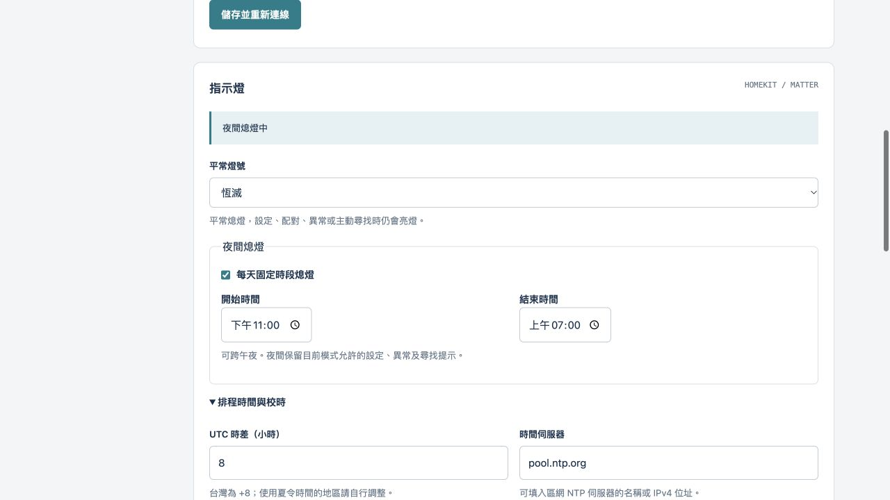

# LED 控制與夜間排程實作驗證

日期：2026-10-21。版本：v0.2.11-preview，software version 13。報告類型：一般韌體整合，flavor = null。

## 結果

已實作六種指示燈模式、15 秒尋找、家庭協議辨識、夜間熄燈與 NTP／手機校時。HomeKit、Matter 共用登入後的面板及持久設定。LED 改由獨立程序處理，原協議仍各自獨占 MCU。原生與 MIPS 更新／管理測試各 55 項通過；部署測試 12 項通過、1 項歷史診斷版跳過。原機尚待使用者以 OTA 安裝驗收。

授權及時間線見 [scope](led-analysis/scope.md)、[timeline](led-analysis/timeline.md)。使用方式、API 及燈號順序見[操作文件](led-control.md)。

## Evidence

| ID | 來源與觀察 | 可重現方式 |
|---|---|---|
| E-imports | [原廠 ELF 證據](../verification/led-imports-v0.2.11.json)，MIPS-I BE o32、207 個 imports；read、GPIO／Identify 函式與既有反組譯相符 | 從固定公開基底提取 `bin/homekitserver`，以 `rabin2 -I`、`rabin2 -ij` 檢查 |
| E-hook | [HomeKit hook](../verification/homekit-led-v0.2.11-results.json)，在原廠 loader／libc 執行讀取橋接、回應觀察與辨識信箱；可完整還原原 ELF | `python3 tests/test_homekit_led.py --output verification/homekit-led-v0.2.11-results.json` |
| E-tests | [映像驗證](../verification/led-release-v0.2.11-results.json)，原生／MIPS 各 55 項，包括輸入邊界、CSRF、跨午夜、提示順序、保存與慢校時子程序 | 於 Linux 執行 `python3 tests/test_updates.py -v`；MIPS 使用 `CK_TEST_RUNNER=qemu-mips`、`CK_TEST_BIN` 指向測試產物 |
| E-reset | [原廠重置](../verification/homekit-factory-v0.2.11-results.json)，實際交付 ELF 的 `-c` 僅清除合成 pairing 範圍；禁止 MIB 寫入，保留出廠尾段 | `tests/test_homekit_factory.py --release-dir` 指向本版，另指定已建置 toolchains／deps 路徑 |
| E-mcu | [完整系統模擬](../verification/led-mcu-vm-v0.2.11-results.json)，10 次模擬短按、超過 60 秒缺身分時仍可控制；daemon AS 上限 8 MiB | `python3 tests/test_hardware_fallback.py --deps firmware/matter/deps --toolchains firmware/matter/toolchains` |
| E-ui | [瀏覽器操作紀錄](../verification/led-ui-v0.2.11-results.json)，訪客隔離、儲存、手機校時及切協議後設定保留 | `CK_FIXTURE_LED=1 python3 tests/serve_admin_fixture.py`，使用合成測試帳號操作本機面板 |

E-imports SHA-256：`c752370150ac6dba768f075607b31b1ac20dfc4dccfb7ca568e7024e3ddaed3f`。E-hook SHA-256：`6477f25288a914cd17ddee8d634830fd1f04081ec1724693aaa539ae1b84f874`。其餘映像與測試日誌的雜湊保存在對應 JSON；不包含私人 Flash 或裝置設定碼。

## Findings 與 Path

- F-LED（validated，confidence high，evidence_ids E-imports／E-hook／E-tests）：Matter 原有直接 GPIO 寫入已移除；原廠 Identify／GPIO6 初始化寫入由限定雜湊補丁停用，既有 GPIO0／5 與重置流程保留。Path：協議的既有 MCU 回應 → RAM 狀態信箱 → `ck-updater --run-led` → GPIO6。
- F-clock（validated，confidence high，evidence_ids E-tests／E-ui）：排程使用 UTC 錨點及 monotonic 推進，校時不變更系統時間。DNS／UDP 位於期限 12 秒的子程序，失敗重試不阻塞 LED／管理事件迴圈。NTP 測試使用本機 UDP 回覆，驗證來源、nonce、stratum 與失敗結果；慢子程序另驗證繼電器狀態觀察仍繼續。Path：NTP 或登入後手機 UTC → RAM 錨點 → 本地時差與跨午夜判斷 → 平常燈光抑制。
- F-preserve（validated，confidence high，evidence_ids E-tests／E-reset）：設定只新增 `config/led`，一般儲存／協議切換／OTA 保留身分、配對、Wi-Fi 及 kWh。恢復出廠依既有契約清除 LED 偏好。Path：已驗證管理操作 → 現有 journal 原子保存 → 開機載入。

## 驗證範圍

| 檢查 | 結果 |
|---|---|
| 原生 Linux 管理／儲存／OTA | 55 通過 |
| 實際 MIPS updater／HTTP | 55 通過 |
| 部署／保留範圍／ELF 復原 | 12 通過，1 個未交付診斷變體跳過 |
| MCU 引擎 | 574 檢查、100 個命令通過 |
| 啟動 guard／回復檢查 | 6／9 項通過 |
| HomeKit 讀取 hook／重置 | 通過，使用原廠 binary 與合成資料 |
| 瀏覽器管理面板 | 通過；合成裝置，非原機 |
| 原機 RF／MFi／LED 實際表現 | 待 OTA 安裝後驗收 |

整機模擬使用 Malta／Linux 4.19、64 MiB，application AS 上限 8 MiB；目標實機為 RTL8196E、32 MiB、Linux 2.6.30。補跑時 32 MiB 的測試 kernel 在進入 userspace 前沒有主控台輸出，改用既有 64 MiB 測試環境；這不作為實機記憶體驗收。模擬未提供實體 Flash 或網路介面。

映像只能寫入既有 Bank1 rootfs 範圍；公開組裝及簽章核對、保留區全 FF 與憑證排除由部署／公開稽核再次檢查。交付保留既有 Ed25519 信任來源。HomeKit 自訂網頁量測及 kWh 累計仍沿用先前的暫停行為；此次 hook 僅供燈號判斷。

## 後台畫面

以下為隔離測試環境，在 HomeKit 模式保留恆滅與夜間排程的畫面。

